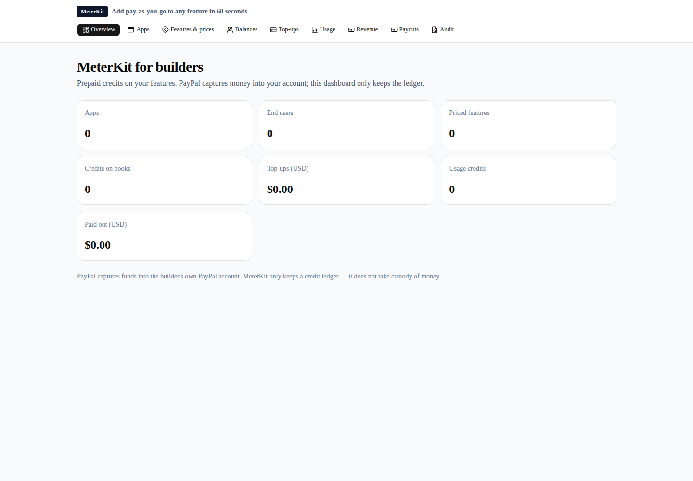
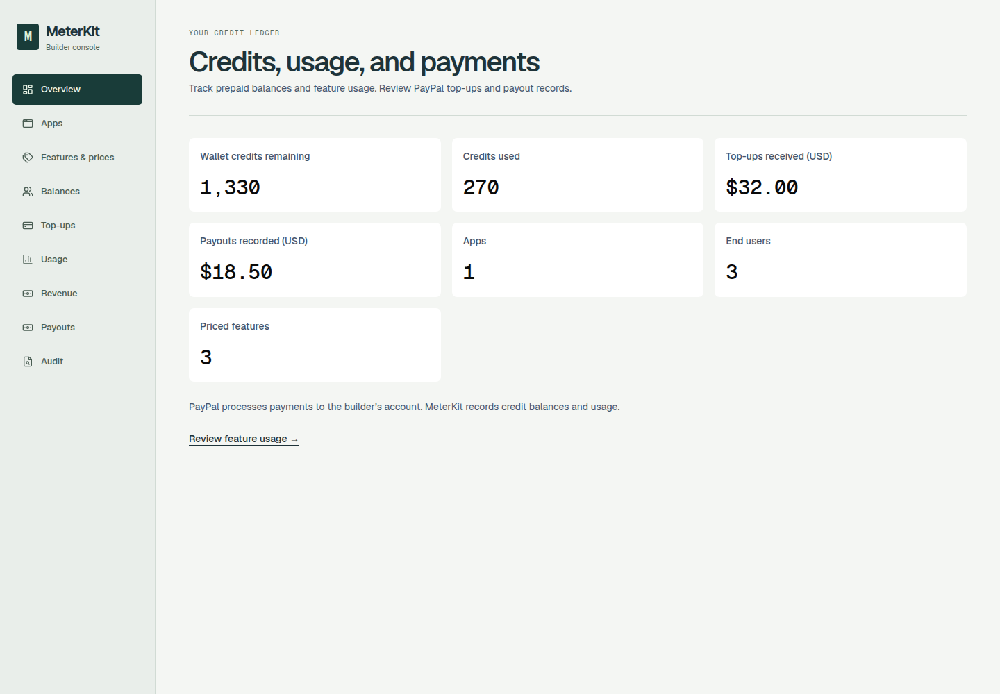
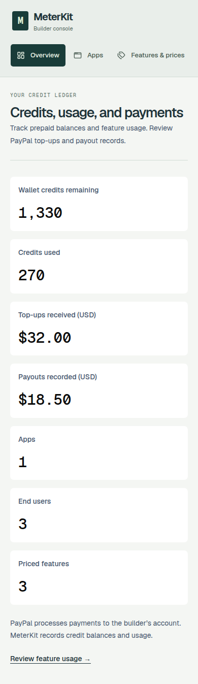

# MeterKit UI, UX, and copy audit

Date: 2026-10-20. Baseline: `1e21a50e25e2801bf93298c81fc3488cd790c897`.

Scope: all 9 active dashboard routes, navigation, feature-price editing, top-ups, payout review, record loading, and the shared low-balance/top-up widgets. Archived `legacy/` screens are not product navigation. Applied the workspace `frontend-design`, `web-design-guidelines`, `browser-automation`, and `no-ai-slop` skills. The Vercel Web Interface Guidelines were fetched from upstream on the audit date.

## Findings and changes

Locations below refer to the baseline, before this PR.

### Navigation and layout

- `apps/dashboard/components/navigation.tsx:47` - a link wraps a button, creating 2 interactive targets for one destination. Render a single styled link, mark the current page, and hide decorative icons from assistive technology.
- `apps/dashboard/app/globals.css` - the font token references itself. This can leave the dashboard in the browser's fallback font. Reference the loaded font correctly.
- Shared shell - add skip navigation, visible focus, larger touch targets, a restrained ink/green ledger layout, tabular metric numbers, and horizontally scrollable mobile navigation without document overflow.
- `apps/dashboard/components/usage-grid.tsx:20` - “No rows yet” does not explain what will appear. Use page-specific empty states and distinguish loading/failure from empty data. Keep sorting/filtering and internal table scrolling.

### Form and transaction feedback

- `apps/dashboard/app/features/page.tsx:57` - price controls have no accessible labels. Add labels, numeric bounds, and specific save buttons.
- `apps/dashboard/app/features/page.tsx:35` - ignores failed saves and reloads over edits. Check HTTP/API results, retain edits on failure, announce saved prices, and warn before leaving with unsaved changes.
- `apps/dashboard/app/top-ups/page.tsx:30` - “Top-up captured” trusts a query parameter. A return URL is not proof of capture. Direct the user to transaction history instead.
- `apps/dashboard/app/top-ups/page.tsx:63` - user and amount inputs are unlabelled. Add labels, required/positive amount validation, a pending state, recoverable errors, and explicit sandbox checkout copy.
- `apps/dashboard/app/payouts/page.tsx:33` - an API result with `payout.status: failed` is not surfaced as an error. Report failure and require amount review before the first POST. Do not claim payout settlement from the response.
- `packages/react/src/LowBalanceModal.tsx:14` - modal lacks an accessible name, Escape handling, and focus containment. Use a named native dialog, keyboard focus loop, and Escape dismissal.
- `packages/react/src/TopUpButton.tsx` - fallback checkout has no pending/error recovery and capture HTTP failure is ignored. Add disabled pending feedback and check capture responses before refreshing the wallet.

### Copy audit

- `packages/config/src/index.ts:12` - unsupported precision: “Add pay-as-you-go to any feature in 60 seconds.” No timed benchmark is supplied. Use “Prepaid credits for your app features” and align README/PRD wording.
- `apps/dashboard/app/audit/page.tsx:17` - “verified PayPal webhooks” overstates the guarantee while the baseline allows an unset webhook ID. Label these “PayPal webhook events.” This PR does not change signature verification.
- “Credits on books” becomes “Wallet credits remaining.” “Idempotency” remains a technical field in data/API contracts, while the usage column says “Request key.”
- “Paid out” becomes “Payouts recorded” because the existing aggregate sums request records, not only settled payouts. Ledger calculations are unchanged.
- Repeated settlement copy is shortened to the concrete relationship: PayPal processes payments; MeterKit records credits and usage. No fee, settlement-speed, revenue, or timing claims are added.

### Data freshness discovered during UI verification

- `apps/dashboard/app/api/{overview,balances,topups,usage,audit,session}/route.ts` - production builds prerendered database-backed GET results. Reproduction: build with an empty local ledger, seed Northwind Chat, then start. `/api/apps` returns 1 app while `/api/overview` returns 0 and `/api/balances` returns no wallets.
- Add `await connection()` before each database read, outside error-catching code, using the installed Next.js documentation. Reads now wait for an actual request instead of using the build snapshot. No debit, credit, payout, or pricing calculation changes.

## What changed

The dashboard now distinguishes records, loading, errors, and empty states. Forms explain their units and keep edits on failure. Sandbox actions require a deliberate action, show pending states, and report failed outcomes. Dashboard reads reflect the current database rather than build-time rows.

## Verification

- `npm test`: 13 tests and 1 CLI snapshot passed across dashboard, CLI, and SDK.
- Dashboard production build: passed. Metered example production build: passed.
- Active dashboard lint (`eslint app components lib`): 0 errors, 0 warnings.
- Repository-wide dashboard lint remains blocked by 17 existing errors in archived `legacy/` pages. Baseline comparison found 18 errors/4 warnings; this PR removes the active top-up error and unused overview import. The legacy errors were neither hidden nor disabled.
- Local post-build ledger check: 1 app and 3 wallets are visible; a 5-credit test debit changes the balances read from 35 to 30 without rebuilding.
- Browser failure checks: failed price save preserves the edited name; payout review sends no POST; a failed payout status is reported; duplicate top-up clicks are blocked while pending; failed checkout becomes retryable; failed overview reads offer retry; fabricated return parameters do not claim added credits.
- Wallet dialog: forward/backward Tab stays inside; Escape closes it. Cancelling the unsaved-price navigation prompt keeps the current page and edits.
- All 9 routes checked at 1440px and 390px with no document-level horizontal overflow. Automated WCAG A/AA checks supplement, not replace, manual screen-reader review.
- All ledger writes were against an isolated, newly created local SQLite demo database. Browser payment tests intercepted sandbox responses. No PayPal transaction, real-money operation, or paid AI call occurred.

## Visual evidence

Before: hosted baseline, 1440px, empty ledger. After: local production build, 1440px/390px, seeded fictional ledger. These images show layout, not production payment acceptance.

## Remaining limits

Supabase durability and PayPal sandbox end-to-end acceptance remain separate deployment gates. Authentication, webhook fail-closed behavior, payout accounting/settlement verification, and the ledger model are not redesigned by this audit. The UI does not claim those gates are passed. Archived lint debt remains visible. Browser checks use synthetic data and do not prove a live integration works.
